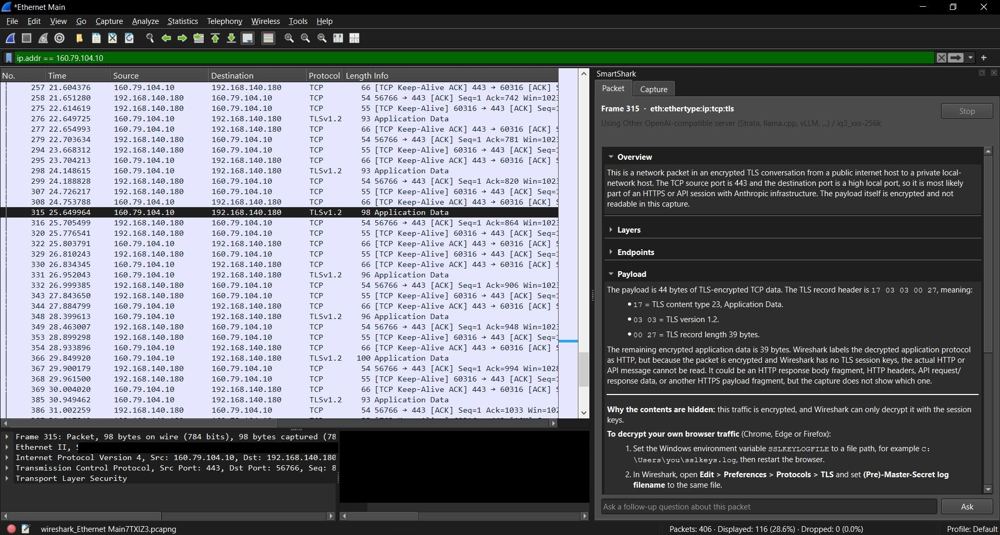
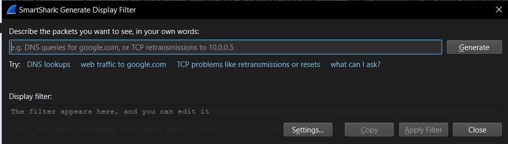
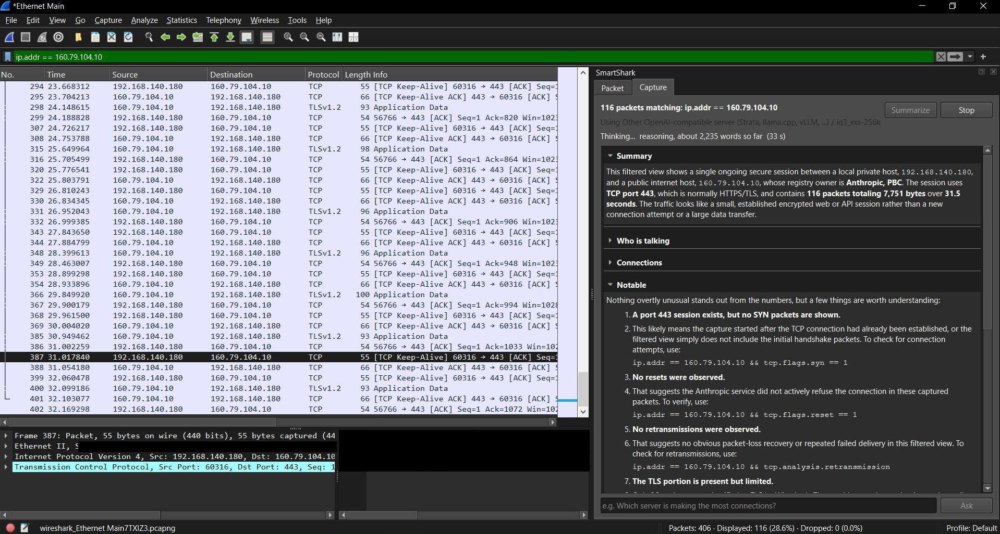
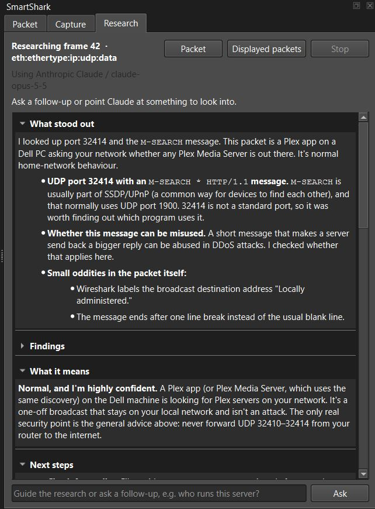
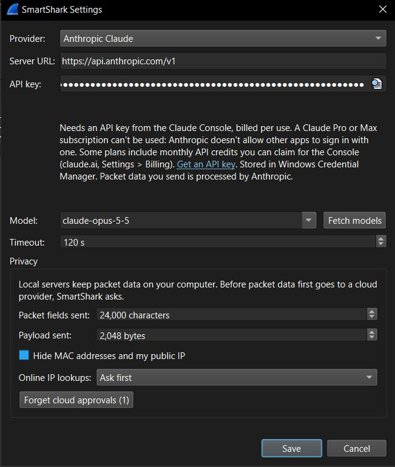

# SmartShark

**AI help inside Wireshark.** Describe the traffic you want to see in plain English and get a working display filter, then ask the AI to explain what the packets mean. Works with cloud AI providers or a model running on your own computer.

SmartShark is a free, open-source plugin for [Wireshark](https://www.wireshark.org/) on Windows.



> **Status:** all features below work and have been tested in Wireshark 4.6.0 on Windows. There is no prebuilt release yet, so for now you have to build it from source.

## Features

### Display filters from plain English

- Type what you want, like *"DNS queries for google.com"* or *"TCP SYN packets to port 443"*, and SmartShark writes the display filter.
- Every filter is checked with Wireshark's own filter compiler before you can apply it. If the AI gets it wrong, SmartShark sends the exact error back and the AI corrects itself.
- Each filter comes with a one-line explanation, so you learn the syntax as you go.
- It builds on the filter you already have: *"also exclude anything from 192.168.1.1"*.
- **No dead ends.** If you ask for something a filter can't do, such as *"which server makes the most connections?"*, SmartShark explains why. It also tells you where in Wireshark to find the answer, offers filters that get you closer and suggests questions it can answer, all clickable.
- Not sure what to type? Click one of the examples, or ask *"what can I ask?"*.



### Packet investigation

Right-click a packet and choose **SmartShark > Explain This Packet** (or **Tools > SmartShark > Explain Selected Packet**). A side panel opens on the right and fills in live. You don't need to know what to ask: every explanation covers the whole packet.

- **Overview**: what the packet is and what it is probably part of.
- **Layers**: each protocol layer in plain language.
- **Endpoints**: a table of facts SmartShark finds itself (private or public address, well-known services such as public DNS resolvers, names Wireshark resolved), then what each address most likely is and what the traffic is for.
  - With your permission, SmartShark also looks up who owns each public address (internet registries, through rdap.org) and its DNS name. It asks once; only the addresses are sent.
- **Payload**: what the packet carries. Data Wireshark could decrypt or reassemble is included. If the traffic is encrypted and Wireshark has no keys, the panel explains how to decrypt your own browser traffic.
- **Notable**: anything unusual, with display filters to check it.
- **Raw data**: the packet's bytes, and any decrypted or reassembled data, as text or hex (collapsed by default).

Ask follow-up questions at the bottom. Sections collapse, and the panel can be resized, undocked or closed. While a model is reasoning, the panel shows its progress, and **Stop** cancels.

### Questions about the whole capture

Use the **Capture** tab of the side panel, or **Tools > SmartShark > Summarize Displayed Packets**.

- Ask things like *"Which server is making the most connections?"* or *"What is this computer talking to?"*, or click **Summarize**.
- SmartShark counts the displayed packets itself and the AI explains what the numbers mean. The counts include protocols, top talkers, conversations, who opens connections to whom, resets and retransmissions, and the DNS, TLS and HTTP names hosts asked for. Answers are based on real numbers, not guesses.
- You get a direct **Answer** to your question, then **Summary**, **Who is talking**, **Connections** and **Notable** sections, plus the raw **Statistics** tables.
- It works on whatever your display filter shows, so you can narrow down first, for example to one host or one protocol.
- If the filter dialog says a request can't be a filter, click **Answer this from the capture** to get it answered here.



### Web research *(needs Anthropic Claude)*

Use the **Research** tab, right-click a packet and choose **SmartShark > Research This Packet on the Web**, or go to **Tools > SmartShark > Research Selected Packet on the Web**.

- Click **Packet** or **Displayed packets**. Claude picks the two to four most unusual or least familiar things (an unknown device maker, an odd port, a server name, a strange payload string), searches the web for them and reports back. You don't need to know what to ask.
- The results are split into **What stood out**, **Findings**, **What it means** and **Next steps**, with display filters to check things yourself.
- **Searches** shows each search as it runs. **Sources** lists the pages the findings cite and the others Claude looked at; click one to open it in your browser.
- Use the box at the bottom to point the research at something ("who runs this server?") or to ask follow-up questions. Claude can search again to answer.
- Each research uses at most 5 web searches. Anthropic charges $10 per 1,000 searches, so that's at most 5 cents, plus the usual token cost.
- Web research only works with Anthropic Claude, because the other providers' APIs that SmartShark uses can't search the web. With another provider, the tab says so and offers **Settings**.



### Privacy controls

- **You are asked first.** The first time packet data would go to a cloud provider, the panel lists what kind of data will be sent and to whom, and waits for you to click **Send**. It asks once per provider. Servers on your computer or local network are not asked about, because the data stays with you.
- **Send less.** In **Tools > SmartShark > Settings**, under **Privacy**, choose how much of each packet's decoded fields is sent and how many bytes of payload (or none).
- **Hide your addresses.** Tick **Hide MAC addresses and my public IP**, and the AI sees placeholders such as `MAC-1` and `HOST-1` instead. This covers MAC addresses in the forms Wireshark writes them (including short forms such as `Intel_4e:66:a1`) and the public IP addresses of this computer's network adapters. Behind a home router, your public IPv4 address usually belongs to the router, not this computer, so it is only hidden if it is on one of your adapters. Other addresses, such as servers and private local addresses, are kept because they help the AI and identify no one. The panel shows the real addresses in the answers.
- **See exactly what was sent.** Each answer has a collapsed **Sent to the AI** section with the packet or capture message the model received, placeholders included. Your follow-up questions are sent as you typed them (with the same placeholders). The rest of the panel shows the real addresses.
- Change your mind about online IP lookups, or make SmartShark ask again about cloud providers, from the same **Privacy** settings.



### Providers

| Provider | Runs | Needs an API key |
|---|---|---|
| LM Studio | On your computer | No |
| Ollama | On your computer | No |
| Any other OpenAI-compatible server (llama.cpp, vLLM, ...) | On your computer or your network | Optional |
| OpenAI | Cloud | Yes |
| Google Gemini | Cloud | Yes |
| Moonshot Kimi | Cloud | Yes |
| DeepSeek | Cloud | Yes |
| Anthropic Claude | Cloud | Yes, a Claude API key from the [Claude Console](https://platform.claude.com/settings/keys). A Claude Pro or Max subscription can't be used: Anthropic doesn't allow other apps to sign in with one. |

SmartShark asks each provider for its current list of models, so new models show up without an update.

With Claude, if Anthropic's safety checks decline a request (this can happen with security-related traffic), newer models automatically retry on a suitable model in the same request. If the request is still declined, SmartShark says so and suggests what to try.


## Installation

Prebuilt releases are not available yet. This section will cover downloading the plugin, which Wireshark version it needs, and where to put it. Until then, see [Building from source](#building-from-source).

## Quick start

1. Open Wireshark and go to **Tools > SmartShark > Settings**.
2. Choose a provider. For a local server, make sure it is running with a model loaded. For a cloud provider, paste your API key.
3. Click **Fetch models**, pick a model, and click **Save**.
4. Open a capture, go to **Tools > SmartShark > Generate Display Filter**, describe what you want to see, and press Enter.
5. Click **Apply Filter**.
6. Right-click any packet and choose **SmartShark > Explain This Packet**.

## Privacy and security

- **Local models keep packet data with you.** With LM Studio, Ollama or another server on your computer, packet data stays there. A server elsewhere on your local network receives it over your network, unencrypted if its address starts with `http://`. Online IP lookups, if you allow them, are separate (see below).
- **Cloud providers receive what you send them.** What each feature sends:
  - **Filter requests:** your request text and the current filter. No packet data.
  - **Packet explanations:** the packet's decoded fields (up to 24,000 characters by default), up to 2 KB of decoded or decrypted payload, facts about its IP addresses (including host names Wireshark resolved and online lookup results), and your follow-up questions.
  - **Capture questions:** statistics, not packets: packet and byte counts, the busiest hosts and conversations with their addresses, and names seen in the capture (DNS lookups, TLS server names, HTTP hosts), plus your questions.
  - **Web research:** the same data as a packet explanation or capture question, sent to Anthropic. Claude's web searches can include names from the capture, such as device makers or server names. It is told never to search for hidden addresses (`HOST-1`, `MAC-1`), private addresses or anything that identifies you.
  - Packet data is marked to the model as untrusted data and the model is told to treat it as data, not instructions. This reduces, but cannot rule out, a crafted packet steering the answer, so treat answers about suspicious traffic with care.
- **SmartShark asks before packet data first goes to a cloud provider**, once per provider, and shows what will be sent. Servers on your computer or local network are not asked about.
- **You can send less.** Under **Privacy** in **Tools > SmartShark > Settings**, limit the packet fields and payload sent, or replace MAC addresses and your public IP with placeholders (`HOST-1`, `MAC-1`). The **Sent to the AI** section in the panel shows the packet or capture message exactly as sent. Host names are still sent when addresses are hidden (except that your own adapter addresses are also hidden inside reverse-DNS and ISP-style names), and an address inside raw payload bytes is only hidden if the same device's address also appears in readable form.
- **IP address lookups are opt-in.** SmartShark asks once before looking up public addresses online, and sends only the addresses (to rdap.org and your DNS server), never packet data. With address hiding on, this computer's own addresses are not looked up.
- **API keys are stored in Windows Credential Manager**, never in a settings file. Each key is tied to the server it was entered for. If you change a provider's server address, SmartShark asks before sending the saved key to the new server.
- **Safeguards:**
  - API keys are never sent over unencrypted `http://` except to a server on your own computer.
  - Requests to the AI server do not follow redirects to other hosts. (Online IP lookups go to rdap.org, which redirects to the right regional registry; no keys or packet data are sent there.)
  - Replies longer than 200,000 characters are stopped, and each request to the AI is stopped after 10 minutes, in case a model gets stuck.
  - AI output and names from the network are shown as formatted text with web content (HTML), images and tooltips switched off. Nothing in them can run code, load images or files, or open links by itself. Only the Research tab's source links open, and only when you click them.
  - If the cloud question appears for an `http://` address, it warns that the data would travel unencrypted.
- **Security review:** before the first release, the code was reviewed for security by an AI model (Anthropic's Fable 5.2), and every finding was fixed. What was found and changed, and how to report a problem, is in [SECURITY.md](SECURITY.md).

## Building from source

SmartShark must be built against the same Wireshark version you have installed (currently 4.6.0), with the same Qt version (6.9.3) and Visual Studio 2022. The full walkthrough, including problems you may hit, is in [docs/building-windows.md](docs/building-windows.md). How the code is organised is in [docs/development.md](docs/development.md) and [docs/design.md](docs/design.md).

In short:

```
scripts\configure.cmd     one-time setup of the Wireshark build
scripts\build.cmd         build the plugin
scripts\test.cmd          run the unit tests
scripts\install.cmd       copy the plugin into your Wireshark plugin folder
```

## Roadmap

- **Next:** a first release with a prebuilt download and an install guide.

## Authorship

The code and documentation in this repository are written by Claude, Anthropic's AI model, working through Claude Code. Commits are authored as Claude. [nigelmcdonald](https://github.com/nigelmcdonald) started the project, sets its direction and runs the work, but does not claim authorship of the code.

## License

SmartShark is free software, released under the GNU General Public License, version 2 or (at your option) any later version. See [LICENSE](LICENSE). This matches Wireshark's own license.

## Acknowledgements

- **[Wireshark](https://www.wireshark.org/)** and its contributors. SmartShark is a plugin for Wireshark and builds against its source. Wireshark is licensed GPL-2.0-or-later. Its `pluginifdemo` example plugin showed how a plugin can add a Qt interface.
- **[Qt](https://www.qt.io/)**, used for the user interface, networking and JSON.
- **[SharkAI](https://github.com/raven-dev-io/sharkai)** by raven-dev-io, a Linux Wireshark plugin with the same goal. We studied it to learn which Wireshark APIs a plugin like this needs. SharkAI has no license, so SmartShark contains none of its code.
- **[WinFlexBison](https://github.com/lexxmark/winflexbison)**, used to build Wireshark on Windows.
- Other projects in this space, which showed us what people want from an AI-assisted Wireshark:
  - [AI Inspector](https://github.com/keithknott26/ai-inspector) by keithknott26
  - [SharkBot](https://github.com/elkentaro/sharkbot) by elkentaro
  - [ai-packet-analyzer](https://github.com/sparshg/ai-packet-analyzer) by sparshg

"Wireshark" is a registered trademark of the Wireshark Foundation. SmartShark is an independent project and is not affiliated with or endorsed by the Wireshark Foundation.
